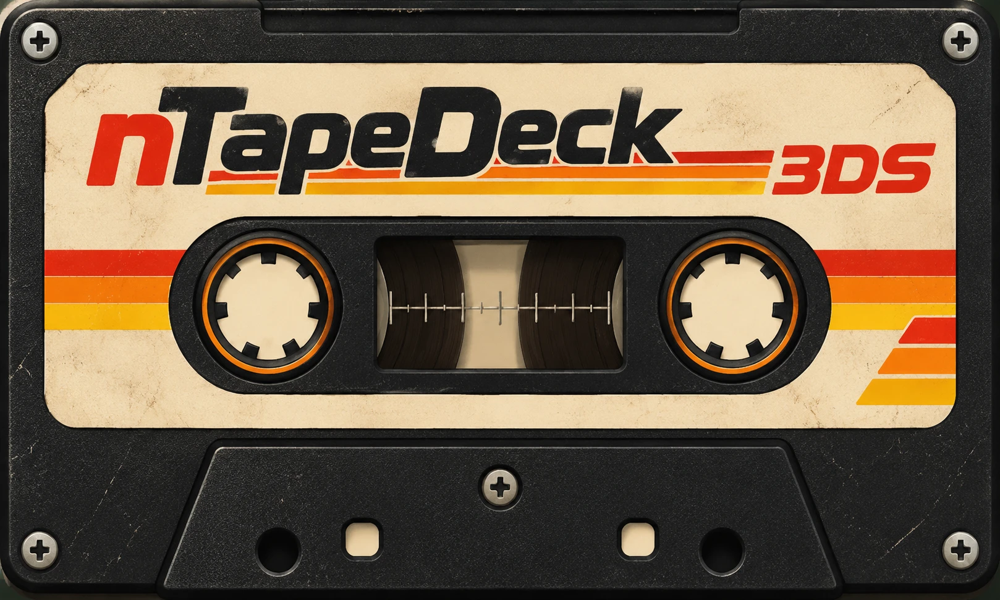
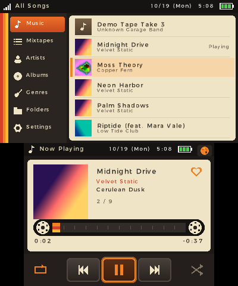
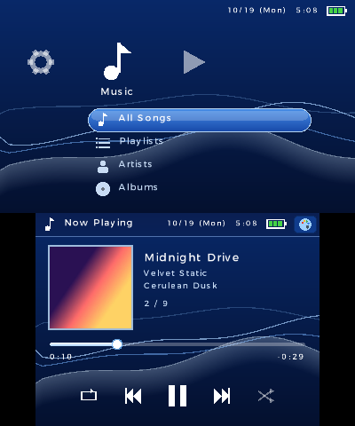
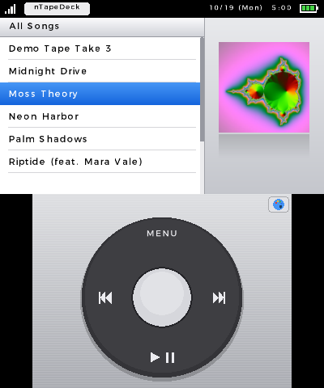
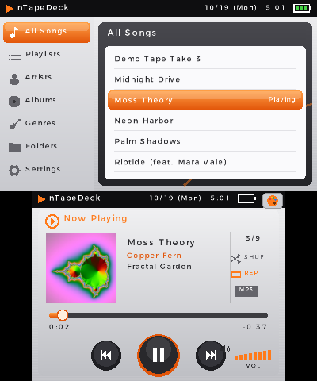
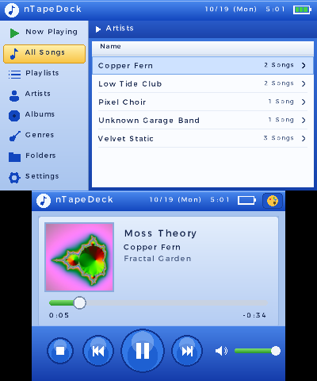
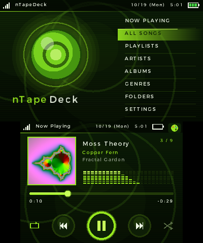

<p align="center"></p>

# nTapeDeck 3DS

An MP3 player for the Nintendo 3DS with six swappable retro themes. Drop your music in an `MP3`
folder on the SD card, pick a look, and keep listening with the lid closed.

<p align="center"></p>

## Features

- **Six themes,** switchable from the palette button in the top-right corner of the bottom
  screen (or SELECT). The last theme you used is restored at the next launch.
- **Library from your tags:** browse All Songs, Artists, Albums, Genres and Folders, built from ID3
  tags. Album art comes from the cover embedded in the MP3, or a `cover.jpg`/`folder.jpg` next to
  it.
- **Playlists:** `.m3u` files in your music folder, plus Favorites (tap the heart while a song
  plays) and Recently Added.
- **Playback:** shuffle, repeat (all / one), seeking, volume, and a spectrum visualizer in the
  themes that show one.
- **Lid closed, music on:** the screens switch off and playback continues.
- **Touch controls** on every theme, including a working click wheel.

## Themes

| | |
|---|---|
| **Tape Deck** (default): cassettes, index cards, turning reels<br> | **Wave:** a cross media bar over flowing waves<br> |
| **Click Wheel:** a pocket player with a touch click wheel<br> | **Portable:** a silver and orange personal stereo<br> |
| **Media Blue:** a glossy blue desktop media player<br> | **Dashboard:** a neon green console dashboard<br> |

The themes are original drawings inspired by classic music players. They contain no logos or
artwork from those products.

## Install

You need a 3DS with custom firmware (Luma3DS) and the Homebrew Launcher.

1. Download `nTapeDeck.3dsx` from the [Releases](../../releases) page and copy it to `sdmc:/3ds/`.
2. Put your music in `sdmc:/MP3/`. Subfolders are fine.
3. Sound needs a DSP firmware dump at `sdmc:/3ds/dspfirm.cdc`. If you've never made one, run the
   [DSP1](https://github.com/zoogie/DSP1) homebrew once.
4. Start **nTapeDeck 3DS** from the Homebrew Launcher.

## Controls

| Button | Action |
|---|---|
| D-pad / Circle Pad | Move (hold to scroll, hold ZR to jump 10) |
| A / B | Open / back |
| Left / Right in Settings | Change a value |
| X | Show Now Playing on the top screen |
| Y | Shuffle on/off |
| START | Play / pause |
| L / R | Previous / next song |
| SELECT | Theme picker |
| In Now Playing: Up/Down, Left/Right | Volume, seek 10 seconds |

Settings, favorites and your theme are saved in `sdmc:/3ds/nTapeDeck/`.

## Playlists

Put `.m3u` or `.m3u8` files anywhere in `sdmc:/MP3/`. Entries can be relative to the playlist
(`Album/01 Song.mp3`) or absolute (`/MP3/Album/01 Song.mp3` or `sdmc:/MP3/...`).

## Building

Install [devkitPro](https://devkitpro.org/wiki/Getting_Started) with the `3ds-dev` group, then:

```sh
make
```

This produces `nTapeDeck.3dsx`. Every push to GitHub is also built automatically (see the
*Actions* tab).

`make AUTOTEST=1` builds `nTapeDeck-test.3dsx`, a self-test that walks every theme through its
screens and saves screenshots to `sdmc:/3ds/nTapeDeck/shots/`. It's how the screenshots above
were made in the [Azahar](https://azahar-emu.org) emulator.

## Credits

- MP3 decoding: [minimp3](https://github.com/lieff/minimp3) (CC0)
- Image decoding: [stb_image](https://github.com/nothings/stb) (public domain)
- Built with [libctru](https://github.com/devkitPro/libctru), citro2d and citro3d
- App and artwork by Nova White
